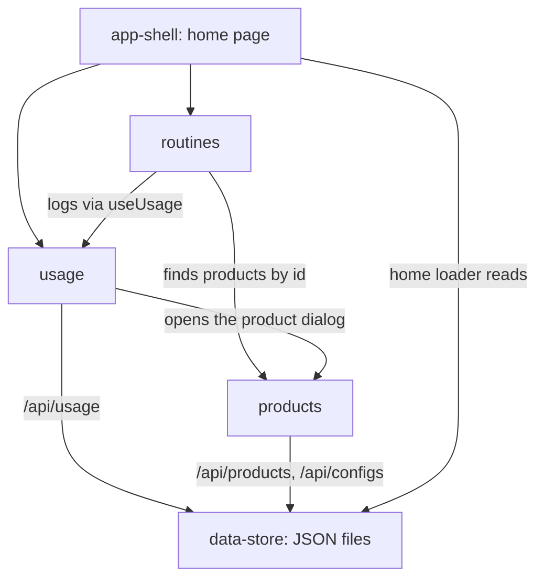

# High-Level Design: beauty-tracker

## Problem

It is hard to judge whether a beauty product was worth what it cost, and easy to buy another product in a category you already have covered. A receipt says what you paid, and a drawer says what you own, but neither says how much you actually use each product. Without that, "was this worth it?" and "do I need another one?" are guesses.

## Approach

Track three things per product and combine them:

- **Usage** — a running count of how often each product is used, kept per month. Logging must be fast enough to do every day: one click per product, or one click per routine for products used together.
- **Purchases** — what each product cost. Combined with usage, this gives **cost per use**: price divided by total uses.
- **Inventory** — which products you currently own, grouped by category. Before buying, you can see what you already have in that category and how much each is used.

All data is entered by hand in the app. The app shows numbers; the user draws conclusions.

## Target Users

A single person tracking their own skincare and makeup collection, using the app on their own computer.

## Goals

1. Logging a use takes one click — per product, or per routine.
2. For every product with a recorded price, the app shows its cost per use.
3. For any category, the app shows every product you own in it, with its use counts.
4. Every kind of data — products, uses, routines, categories, purchases — can be created and edited in the app, without opening a data file.

## Non-Goals

- **Multiple users or accounts.** One person's collection only.
- **Remote or mobile access.** The app runs locally on the user's computer.
- **Product catalog lookups.** No fetching product details, ingredients, or prices from external sources.
- **Automatic imports.** No importing purchases from receipts, email, or order history.
- **Recommendations.** The app does not suggest what to buy, discard, or use next.

## Tenets

In priority order — when two conflict, the higher one wins.

1. **The app is the only writer.** Data changes go through the app, which validates them; data files are storage, not an editing surface.
2. **Low friction over precision.** When logging must trade effort against exactness, choose fewer clicks and let the user correct mistakes afterward.
3. **Simplicity over robustness.** For a single local user, accept rare edge cases rather than adding machinery to prevent them.

## System Design

A React Router app rendered on the server, storing all data as JSON files on the local machine. Five segments, all at the root level of the design tree:

| Segment | Purpose | Design | Spec prefix |
|---|---|---|---|
| products | Product records, categories, adding and editing products | [products-design.md](intent/products/products-design.md) | `PROD` |
| usage | Monthly use counts, logging a use, the usage table | [usage-design.md](intent/usage/usage-design.md) | `USAGE` |
| routines | Named product groups logged together in one click | [routines-design.md](intent/routines/routines-design.md) | `ROUT` |
| data-store | JSON file storage, dev/prod data folders, configuration API | [data-store-design.md](intent/data-store/data-store-design.md) | `STORE` |
| app-shell | Root layout, theme, error page, routes, home page composition, shared controls | [app-shell-design.md](intent/app-shell/app-shell-design.md) | `SHELL` |

Purchases and inventory (Goals 2 and 3) are not yet designed and have no segments.

## Key Design Decisions

| Decision | Chosen | Alternatives Considered | Rationale |
|---|---|---|---|
| Deployment | Local server-rendered web app | Hosted web app; native mobile app | Single user on one computer; no hosting, accounts, or sync needed |
| Storage | JSON files on local disk | SQLite; hosted database | Small data, one writer, no infrastructure; consistent with *Simplicity over robustness* |
| Usage granularity | Counts per product per month | Timestamped log of each use; a single lifetime total | Monthly counts answer cost-per-use and usage-trend questions at a fraction of the data; per-use timestamps add nothing the goals need |
| Write validation | Each segment validates writes to the data it owns, at the API route that accepts them; the data store only reads and writes files | Central per-file schemas enforced by the data store; validation only in editing forms | Keeps data rules with the segment that defines the data and adds no dependency; form-only validation would let other callers bypass *The app is the only writer* |
| Product ownership | A products segment owns the record and categories; usage depends on it and owns changes to counts | Products depends on usage; product editing stays inside usage | A count belongs to a product, not the reverse, so purchases and inventory can build on products without depending on usage. Both segments' fields share one record in `usage.json`, so no data migration is needed |
| Bulk logging | Routines that log every product in them at once | Per-product logging only | Daily routines would otherwise take a click per product, against *Low friction over precision* |

## Success Metrics

- Day-to-day use never requires opening a data file. Falsified if any routine kind of change — adding a product, logging a use, editing a routine or category — still needs a hand edit.
- Before a purchase, "what do I already own in this category, and how much do I use it?" is answerable from one screen.
- Cost per use is visible for every product with a recorded price.

## References

- README.md
- docs/arrows/index.yaml
