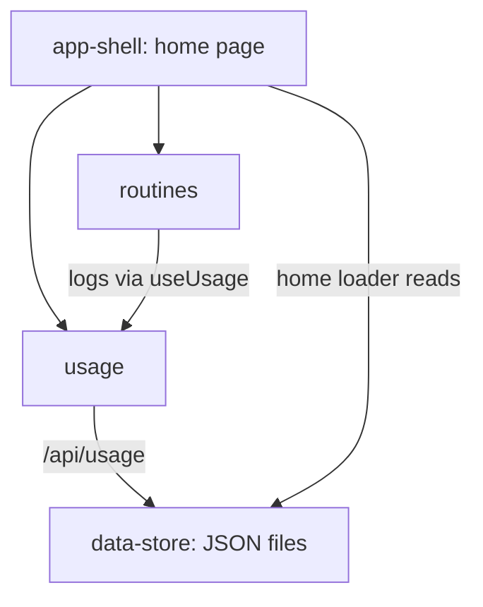

# High-Level Design: beauty-tracker

## Problem

*(not yet specified)*

[inferred] It's hard to know which beauty products actually get used and which sit idle; tracking use by hand is tedious enough that it doesn't happen.

## Approach

*(not yet specified)*

[inferred] A small single-user web app: one record per product with a monthly use count, one-click logging per product or per routine, and a table showing every product's usage at a glance.

## Target Users

*(not yet specified)*

[inferred] A single person tracking their own skincare and makeup collection.

## Goals

*(not yet specified)*

[inferred] The README names three areas — purchases, inventory, and usage. Usage tracking is built; purchases and inventory are not.

## Non-Goals

*(not yet specified)*

## Tenets

*(not yet specified)*

## System Design

[inferred] A React Router app rendered on the server, storing all data in JSON files in the repository. Four segments, all at the root level of the design tree:

| Segment | Purpose | Design | Spec prefix |
|---|---|---|---|
| usage | Product records, monthly use counts, logging a use, the usage table | [usage-design.md](intent/usage/usage-design.md) | `USAGE` |
| routines | Named product groups logged together in one click | [routines-design.md](intent/routines/routines-design.md) | `ROUT` |
| data-store | JSON file storage, dev/prod data folders, configuration API | [data-store-design.md](intent/data-store/data-store-design.md) | `STORE` |
| app-shell | Root layout, theme, error page, routes, home page composition, shared controls | [app-shell-design.md](intent/app-shell/app-shell-design.md) | `SHELL` |

## Key Design Decisions

*(not yet specified)*

## Success Metrics

*(not yet specified)*

## References

- README.md
- docs/arrows/index.yaml
